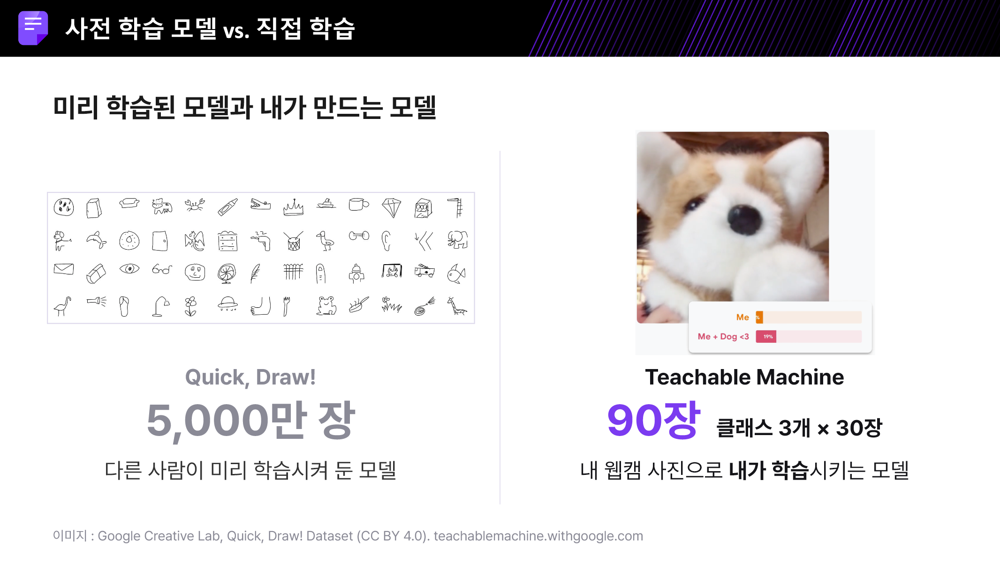
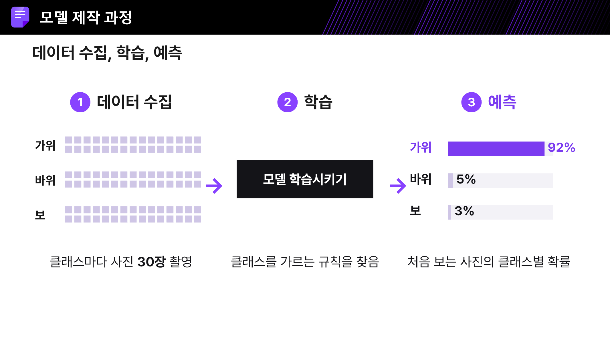
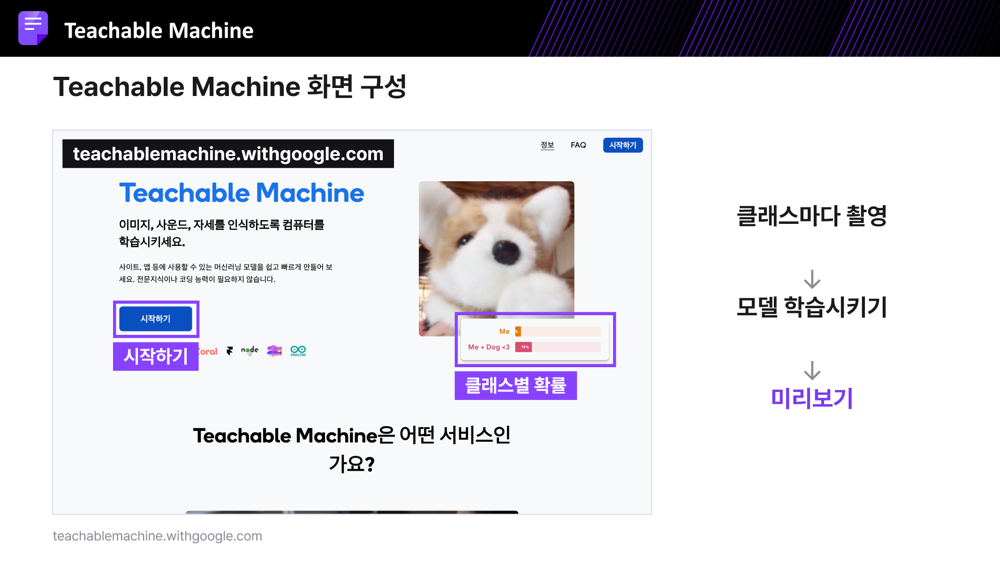
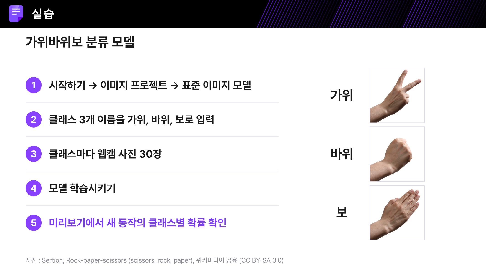
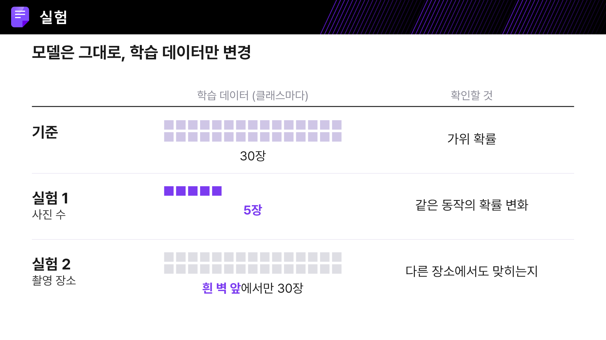
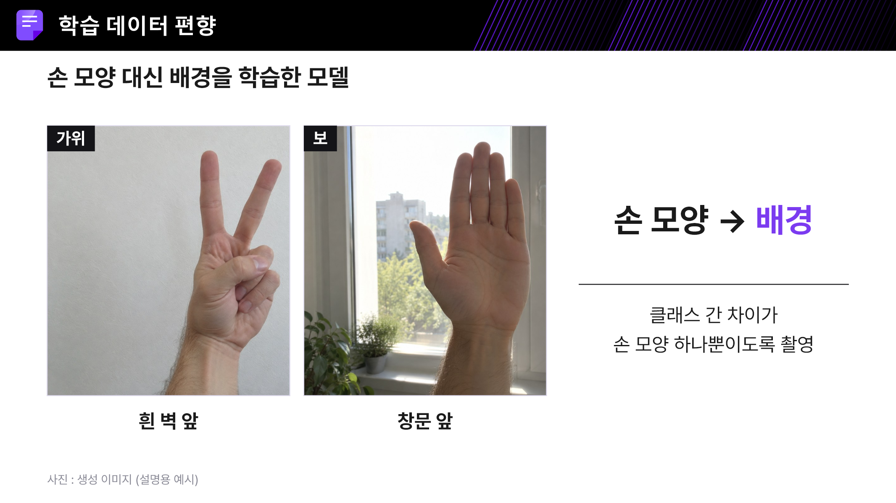
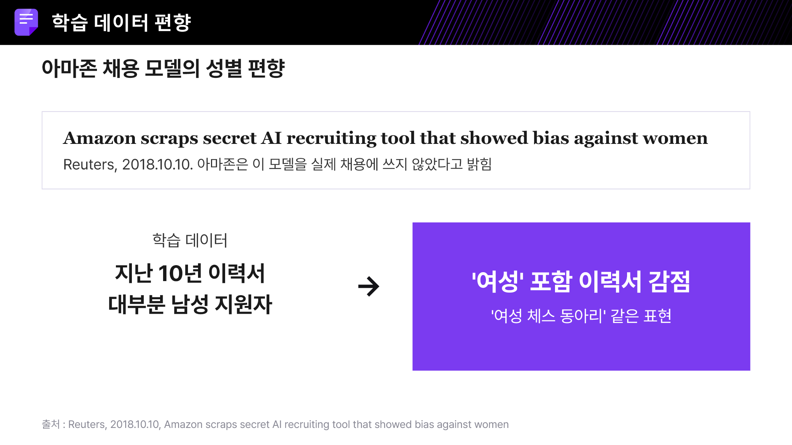
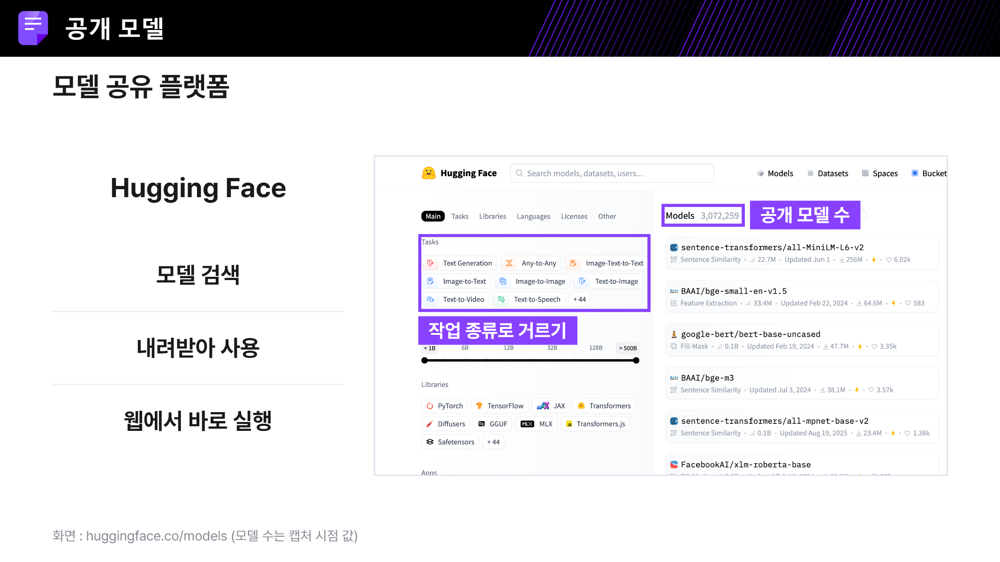
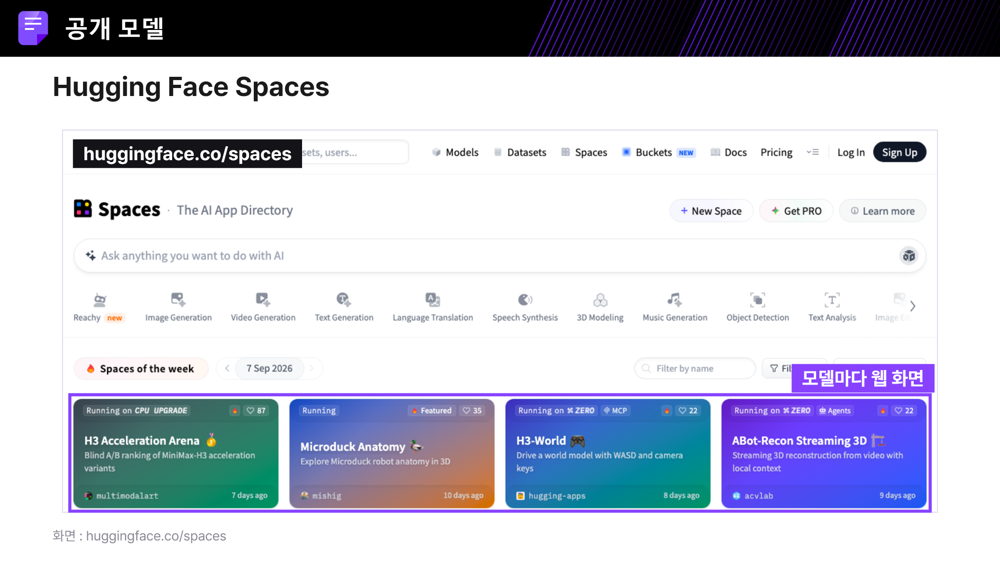

# 3주차 교육 정리: Teachable Machine으로 이미지 분류 모델 만들기

이 문서는 강의 자료 14장과 발표자 노트를 읽고 정리한 복습 자료입니다. 슬라이드 번호를 각 설명에 표시했습니다. 그림은 원본 PPTX의 해당 슬라이드를 PNG로 변환했으며, 내용을 새로 그리거나 변경하지 않았습니다. 글꼴과 렌더링 환경에 따라 PowerPoint와 표시가 조금 다를 수 있습니다.

- [강의 원본 PowerPoint](./Teachable_Machine으로_이미지_분류_모델_만들기.pptx)
- [실습 앱 실행](https://leeoppa84.github.io/study/week03/)
- 자료 전체의 핵심: **모델이 무엇을 배웠는지는 학습 데이터에 달려 있다. 잘 맞히는 것뿐 아니라 무엇을 보고 맞혔는지도 확인해야 한다.**

## 1. 이번 시간에 배워야 할 것

출처: 슬라이드 1~2, 13~14

1. **데이터 수집 → 학습 → 예측**의 흐름으로 이미지 분류 모델을 만든다.
2. 사진 수나 촬영 장소를 바꿨을 때 예측이 어떻게 달라지는지 실험한다.
3. 틀린 결과의 원인을 코드뿐 아니라 **학습 데이터의 부족과 치우침**에서도 찾는다.

예를 들어 가위를 잘 맞히던 모델이 다른 방에서는 틀린다면, 손 모양보다 방의 배경이나 조명에 의존했을 수 있다.

## 2. 이미 만들어진 모델 사용과 직접 학습의 차이

출처: 슬라이드 3

| 구분 | 강의에서 제시한 예 | 내가 하는 일 |
|---|---|---|
| 다른 사람이 학습한 모델 사용 | Quick, Draw!와 공개 낙서 데이터 5,000만 장 | 이미 준비된 모델에 입력을 넣고 결과를 확인 |
| 내 데이터로 분류기 학습 | Teachable Machine: 클래스 3개 × 사진 30장 = 90장 | 분류 항목을 정하고 사진을 모아 학습한 뒤 평가 |

**숫자의 의미:** 5,000만 장은 자료가 소개하는 공개 데이터 규모이며, 90장은 이 수업의 실습 구성이다. 두 숫자만으로 모델의 성능을 비교할 수 없다.

**보충 설명:** 자료의 ‘직접 학습’은 사용자가 자기 데이터를 모아 분류기를 학습한다는 뜻이다. Teachable Machine 이미지 모델은 사전 학습된 MobileNet의 특징을 재사용하는 **전이 학습**을 활용한다. 신경망의 모든 부분을 90장만으로 처음부터 학습하는 의미로 이해하면 안 된다. [공식 구현](https://github.com/googlecreativelab/teachablemachine-community/blob/master/libraries/image/src/teachable-mobilenet.ts)

## 3. 모델을 만드는 세 단계

출처: 슬라이드 4~5

| 단계 | 하는 일 | 가위바위보 예 |
|---|---|---|
| 데이터 수집 | 정답 이름을 붙여 사진을 모은다 | 가위·바위·보 사진을 각각 30장 촬영 |
| 학습 | 사진과 정답을 이용해 분류 규칙을 조정한다 | 세 손 모양을 구분하도록 학습 |
| 예측 | 학습 때 사용하지 않은 입력으로 결과를 확인한다 | 새로운 손동작에 대한 클래스별 점수 확인 |

**클래스**는 모델이 구분할 정답 항목이다. 이 실습에서는 ‘가위’, ‘바위’, ‘보’가 클래스다.

슬라이드의 예시는 가위 92%, 바위 5%, 보 3%다. 이것은 **입력 한 장에 대한 분류 점수 예시**이며, 모델 전체의 정확도가 92%라는 뜻이 아니다. 여러 새로운 사진의 실제 정답과 예측을 비교해야 정확도를 평가할 수 있다.

화면에서는 클래스별 사진 수집, 모델 학습, 미리보기 결과 확인의 순서로 진행한다.

## 4. 가위바위보 실습 순서

출처: 슬라이드 6~7

1. [Teachable Machine](https://teachablemachine.withgoogle.com/)을 브라우저에서 연다.
2. **시작하기 → 이미지 프로젝트 → 표준 이미지 모델**을 선택한다.
3. 클래스를 세 개 만들고 이름을 **가위 / 바위 / 보**로 입력한다.
4. 클래스마다 사진을 30장씩 모은다. 손 전체가 보이게 하고 각도와 거리를 조금씩 바꾼다.
5. **모델 학습시키기**를 누른다.
6. 학습 완료 후 미리보기에서 새 동작을 보여 주고 클래스별 점수를 확인한다.

**실습 전 확인:** 카메라 권한, 손이 잘리는지, 조명이 너무 어둡지 않은지 확인한다. 웹캠이 없으면 휴대폰 사진을 파일로 업로드할 수 있다. 30장은 수업의 시작 기준이며, 어떤 문제에서든 충분한 사진 수를 보장하는 값은 아니다.

## 5. 가장 중요한 실험: 데이터만 바꾸기

출처: 슬라이드 8

아래는 원본 실험 비교표를 텍스트 표로 옮긴 것이다.

| 조건 | 학습 데이터: 클래스마다 | 확인할 것 |
|---|---|---|
| 기준 | 30장 | 가위 확률 |
| 실험 1: 사진 수 | 5장 | 같은 동작의 확률 변화 |
| 실험 2: 촬영 장소 | 흰 벽 앞에서만 30장 | 다른 장소에서도 맞히는지 |

**실험 1에서 배울 점:** 사진을 줄이면 모델이 접하는 경우의 수가 줄어든다. 다만 5장 모델이 항상 더 낮은 점수를 내는 것은 아니다. 높은 점수를 내면서 틀릴 수도 있으므로, 점수뿐 아니라 **새 입력을 실제로 맞혔는지** 기록한다.

**실험 2에서 배울 점:** 학습할 때 잘 맞혔던 환경을 벗어나도 작동하는지 확인한다. 같은 손동작을 책장 앞, 창문 앞, 다른 조명에서도 보여 준다.

### 복습할 때 쓸 기록표

아래는 강의 실험을 실제로 비교하기 위한 **추가 기록 양식**이다. 측정값은 비워 두었으며, 실험 후 직접 채운다.

| 조건 | 시험 사진/동작 수 | 맞힌 수 | 정확도: 맞힌 수 ÷ 전체 수 | 자주 틀린 상황 |
|---|---:|---:|---|---|
| 클래스당 30장 학습 |  |  |  |  |
| 클래스당 5장 학습 |  |  |  |  |
| 흰 벽에서 학습, 다른 장소에서 시험 |  |  |  |  |

각 조건의 학습을 마친 뒤 같은 시험용 사진 묶음으로 비교하면 차이를 해석하기 쉽다. 시험용 사진을 학습에 다시 넣으면 평가가 유리해질 수 있으므로 분리해 둔다.

## 6. 배경 편향과 지름길 학습

출처: 슬라이드 9

가위 사진은 전부 흰 벽 앞에서, 보 사진은 전부 창문 앞에서 찍으면 손 모양과 배경이 정답에 함께 연결된다. 모델은 손가락보다 배경을 이용해 쉽게 분류할 수 있다. 이처럼 의도하지 않은 단서에 기대는 현상을 수업에서는 **지름길 학습(shortcut learning)**으로 설명한다.

| 잘못 모으기 쉬운 데이터 | 생길 수 있는 문제 | 개선 방향 |
|---|---|---|
| 가위는 흰 벽, 보는 창문 앞에서만 촬영 | 손 모양보다 배경에 의존 | 모든 클래스에 여러 배경을 고르게 포함 |
| 한 클래스는 밝게, 다른 클래스는 어둡게 촬영 | 조명으로 구분 | 각 클래스에 밝기 조건을 섞기 |
| 같은 각도에서 연속 촬영만 반복 | 비슷한 사진은 많지만 새로운 시점에 약함 | 각도·거리·손 위치를 바꾸기 |
| 내 손으로만 학습하고 내 손으로만 확인 | 다른 사람에게도 되는지 알 수 없음 | 다른 사람의 손으로 따로 시험 |

‘클래스 간 차이는 손 모양’이라는 설명은 **각 클래스가 공유하는 배경·조명 조건을 고르게 맞추라**는 뜻이다. 모든 사진을 한 배경에서만 찍어도 된다는 뜻은 아니다.

## 7. 데이터 편향은 현실의 판단에도 이어진다

출처: 슬라이드 10

자료는 2018년 Reuters 보도를 인용해, 남성 지원자가 많은 과거 이력서 데이터로 학습한 채용 모델이 여성 관련 표현에 불리한 점수를 주었던 사례를 소개한다. 자료에는 해당 모델을 실제 채용에 쓰지 않았다는 회사 설명도 함께 적혀 있다.

수업의 메시지는 **과거 데이터의 치우침을 모델이 그대로 배울 수 있다**는 것이다. 데이터가 많아도 어떤 사람·상황이 빠져 있는지, 정답과 관계없는 단서를 이용하는지 살펴야 한다.

## 8. 다른 사람이 만든 모델을 활용하는 방법

출처: 슬라이드 11~12

| 서비스/메뉴 | 역할 | 사용 예 |
|---|---|---|
| [Hugging Face Models](https://huggingface.co/models) | 모델을 검색하고 작업 종류로 좁히기 | 이미지 분류, 문장 생성 등 목적에 맞는 모델 찾기 |
| [Hugging Face Spaces](https://huggingface.co/spaces) | 모델을 연결한 웹 데모/앱 사용 | 화면에서 입력을 넣어 기능을 체험 |

**주의해서 읽을 부분:** 슬라이드의 모델 수는 캡처 시점의 수치이며 현재 개수를 뜻하지 않는다. Spaces도 앱별로 공개 범위, 로그인 요구, 실행 상태가 다르므로 ‘모든 앱이 언제나 로그인 없이 즉시 실행된다’고 일반화하지 않는다. [공식 Spaces 설명](https://huggingface.co/docs/hub/spaces-overview)

## 9. 현재 얼굴·피규어 앱에 적용하기

이 절은 강의 원문이 아니라 **이번 실습 앱에 연결한 보충 설명**이다.

현재 모델은 ‘나의 얼굴’과 ‘슈퍼걸 피규어’ 두 클래스를 비교한다. 다른 물건을 비춰도 그중 하나에 높은 점수가 나올 수 있다. 따라서 ‘피규어 100%’라는 표시만으로 일반적인 사물 인식 능력을 갖췄다고 볼 수 없다.

1. 얼굴과 피규어를 **같은 여러 배경·조명·거리 조건**에서 각각 촬영한다.
2. 빈 배경, 다른 물체, 다른 사람 등도 시험해 본다. 필요하면 ‘기타/대상 없음’ 클래스를 추가해 재학습한다. 단, 기타 클래스를 추가해도 세상의 모든 미등록 물체를 알아서 거절하는 것은 아니다.
3. 학습에 사용하지 않은 사진과 다른 휴대폰으로 확인한다.
4. 단일 사진의 점수와 시험 묶음 전체의 정확도를 구분한다.
5. **웹페이지 코드를 바꾸는 것과 모델을 다시 학습하는 것은 다르다.** 디자인·버튼·카메라 오류를 수정해도 분류 능력이 자동으로 개선되지는 않는다.

### 모델 파일과 웹페이지의 역할

| 파일 | 역할 |
|---|---|
| `model/model.json` | 모델 구조와 가중치 파일 참조 |
| `model/weights.bin` | 학습한 수치 가중치 |
| `model/metadata.json` | 클래스 이름, 이미지 크기 등의 정보 |
| `app.js` | 카메라/사진 입력, 모델 호출, 결과 표시 |
| `index.html` | 웹페이지 화면 구성과 스타일 |

**클래스 이름만 수정해도 새 물건을 인식하게 되지는 않는다.** 분류 대상이 바뀌면 데이터를 다시 모아 학습하고, 내보낸 모델 파일 세 개를 함께 교체해야 한다.

## 10. 복습 체크리스트

- [ ] 데이터 수집, 학습, 예측의 차이를 내 말로 설명할 수 있다.
- [ ] 클래스마다 사진 30장을 모아 가위바위보 모델을 만들 수 있다.
- [ ] 사진을 5장으로 줄인 실험 결과를 실제 기록으로 비교할 수 있다.
- [ ] 배경을 바꿔 시험하고, 모델이 배경에 의존하는지 설명할 수 있다.
- [ ] 높은 분류 점수와 높은 정확도가 다르다는 점을 설명할 수 있다.
- [ ] Hugging Face Models와 Spaces의 역할을 구분할 수 있다.
- [ ] 현재 앱의 개선에 코드 수정이 필요한지 재학습이 필요한지 구분할 수 있다.

## 원본 이미지 출처

원본 PPTX에 표시된 출처를 유지한다. 이 문서에 포함된 슬라이드 이미지는 원본의 설명과 출처 표기를 함께 보여 준다.

- 슬라이드 3: Google Creative Lab, Quick, Draw! Dataset (CC BY 4.0), Teachable Machine 화면
- 슬라이드 7: Sertion, Rock-paper-scissors, Wikimedia Commons (CC BY-SA 3.0)
- 슬라이드 9: 설명용 생성 이미지
- 슬라이드 10: Reuters, 2018.10.10 기사에 대한 강의의 설명
- 슬라이드 11~12: Hugging Face 웹 화면 캡처

정리 기준일: 2026-11-05. 원본 강의 내용과 보충 설명을 구분했으며, 실제 실험 결과나 성능 수치를 임의로 만들지 않았다.
